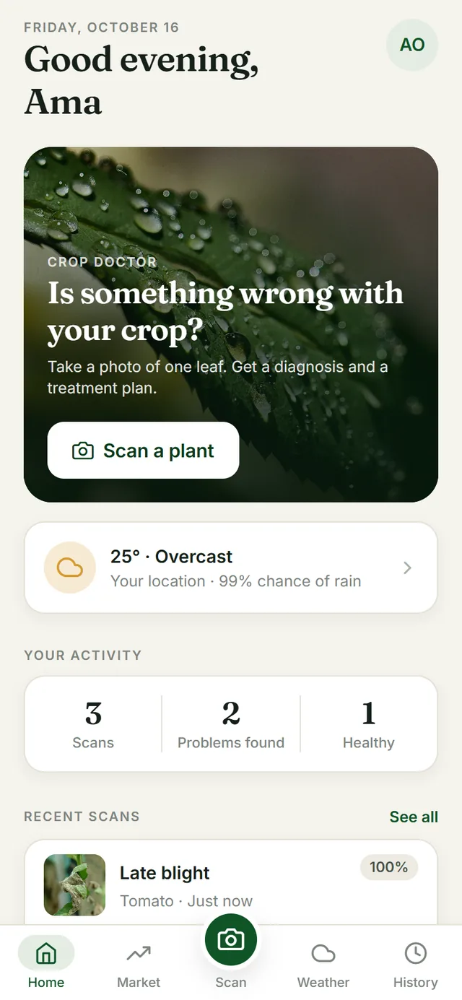
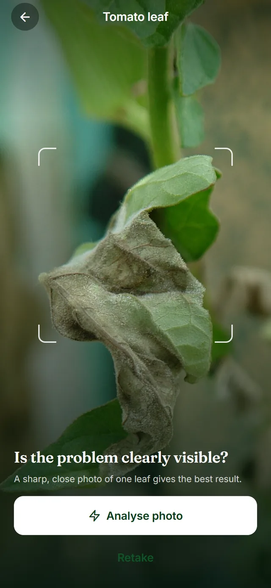
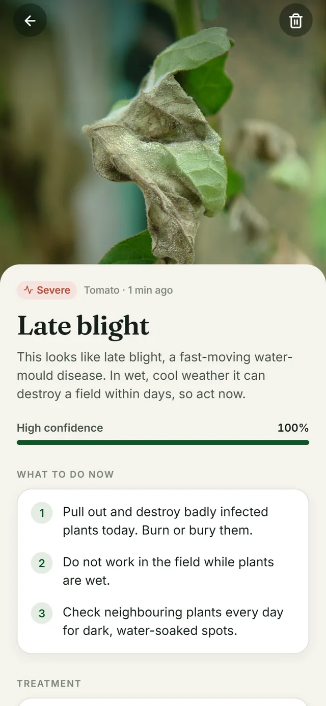
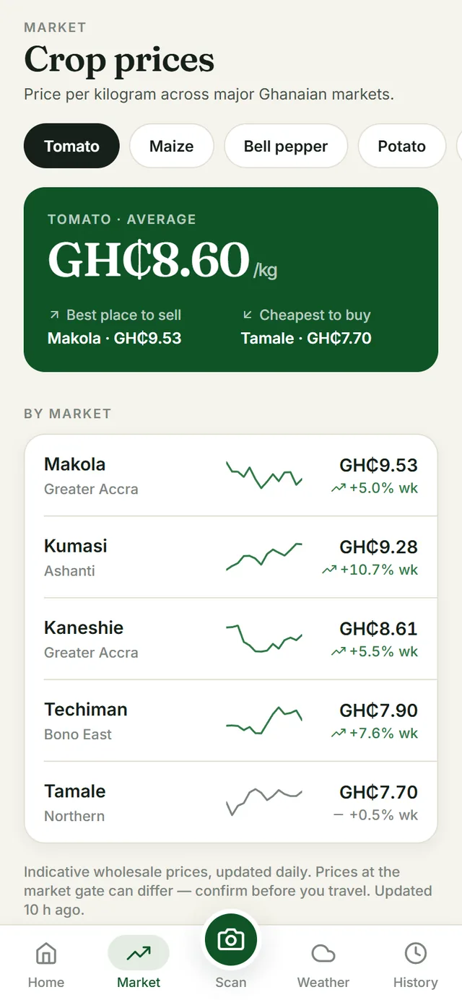
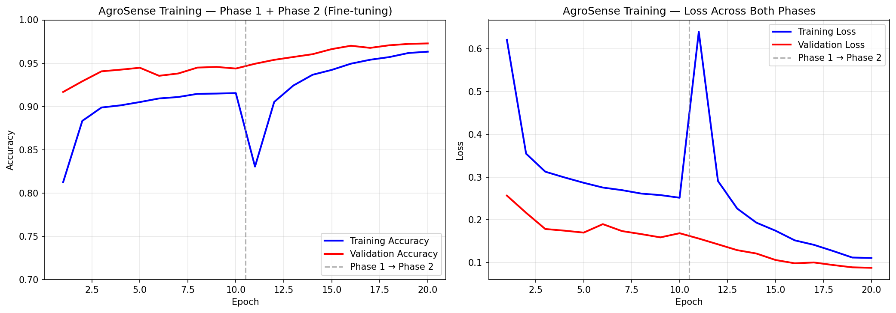

# AgroSense

**A crop doctor in every farmer’s pocket.** AgroSense diagnoses crop disease from a single photo and tells Ghanaian smallholder farmers exactly what to do — with weather-aware planting advice and market prices across five major markets. It works in the app, and over SMS on any phone.

**Website:** https://aimlin9.github.io/agrosense/ · **API:** https://agrosense-g0sb.onrender.com

<p>
  
  
  
  
</p>

## What’s in the repo

| Path | What it is |
|---|---|
| `backend/` | FastAPI API: auth, diagnosis pipeline, weather, prices, SMS webhook, admin. Tested with pytest. |
| `mobile/` | React Native + Expo app for Android and iOS. See [mobile/README.md](mobile/README.md). |
| `docs/` | The marketing website and legal pages, served by GitHub Pages. |
| `notebooks/` | Training curves and sample predictions from model training. |

## The model

Two-phase transfer learning on MobileNetV2, fine-tuned on PlantVillage (54,305 images, 38 classes, 14 crops).

| Phase | What happened | Best val accuracy |
|---|---|---|
| 1 — frozen base | Classification head only, lr 1e-3, 10 epochs | 94.6% |
| 2 — fine-tune | Top 30 layers unfrozen, lr 1e-5, 10 epochs | **97.28%** |

Exported to a 2.7 MB TFLite file. On two public-domain field photos of tomato late blight the model has never seen, it returns *Late blight* at 99.9% and 100%.



## How a diagnosis works

```
photo + crop ─▶ validate type/size ─▶ re-encode JPEG (upright, EXIF/GPS stripped) ─▶ R2 storage
             ─▶ 224×224 tensor ─▶ TFLite (38 classes) ─▶ restrict to the chosen crop
             ─▶ advice: Gemini (cached) ─┬─▶ save Diagnosis ─▶ response
                       curated fallback ─┘
```

Every slow or external step runs off the event loop, and every external service degrades instead of failing the request:

| If this is down… | …the API still… |
|---|---|
| Gemini | returns curated, conservative treatment advice and a rules-based weather advisory |
| Cloudflare R2 | diagnoses the photo (it just isn’t stored) |
| Redis | serves requests; rate limits fall back to memory, caches are skipped (30 s circuit breaker) |
| Open-Meteo | serves the last forecast for up to 7 days, flagged as stale |

Results below 60% confidence, or for crops the model wasn’t trained on, are flagged so the app asks for a better photo and an extension officer’s opinion.

## API overview

| Area | Endpoints |
|---|---|
| Auth | `POST /api/auth/register`, `/login`, `/logout`, `/google`, `/admin/login` · `GET/PATCH/DELETE /api/auth/me` · `PATCH /api/auth/me/complete-profile` · `POST /api/auth/me/password` |
| Diagnosis | `POST /api/diagnose` · `GET /api/diagnoses` (paginated) · `GET /api/diagnoses/stats` · `GET/DELETE /api/diagnoses/{id}` |
| Catalogue | `GET /api/crops`, `/api/diseases` |
| Market | `GET /api/prices/latest` (7-day change + sparkline), `/api/prices`, `/api/prices/trends/{crop_id}` |
| Weather | `GET /api/weather`, `/api/weather/advisory` |
| Farm plots | CRUD on `/api/plots` |
| SMS | `POST /api/sms/webhook` (Twilio, signature-verified) |
| Admin | stats, farmers, diagnoses, expert review under `/api/admin` |
| Health | `/health` (GET/HEAD, touches DB), `/health/ready` (model, DB, Redis) |

Rate limits (per user, or per IP before sign-in): login 10/min, register 5/min, Google 10/min, admin login 5/min, diagnose 10/min and 60/day, weather 60/min, advisory 20/min. All return `429` with `Retry-After`.

## Running locally

**Prerequisites:** Python 3.12, Node 20+, Docker (for Postgres + Redis).

```bash
git clone https://github.com/aimlin9/agrosense.git && cd agrosense
docker compose up -d                       # Postgres 16 + Redis 7

cd backend
python -m venv .venv && source .venv/bin/activate   # Windows: .venv\Scripts\Activate.ps1
pip install -r requirements-dev.txt
cp .env.example .env                       # add SECRET_KEY, and R2/Gemini keys if you have them
alembic upgrade head
python -m scripts.seed_crops_and_diseases
python -m scripts.seed_market_prices       # run daily to keep prices current
uvicorn app.main:app --reload              # http://localhost:8000/docs
```

Then the app: see [mobile/README.md](mobile/README.md). Set `EXPO_PUBLIC_API_URL=http://<your-LAN-IP>:8000` in `mobile/.env` to use your local API from a phone.

## Tests and checks

```bash
cd backend && python -m pytest -q          # 35 tests: real model + routers on SQLite, external services absent
cd mobile && npm run typecheck && npm run lint && npx expo-doctor
```

GitHub Actions runs the backend suite on every push to `backend/`.

## Production notes

- **Environment:** set `ENVIRONMENT=production` (refuses to boot with the default `SECRET_KEY`, hides `/docs`), `SECRET_KEY`, `DATABASE_URL`, `REDIS_URL`, R2, `GEMINI_API_KEY`, Twilio and Google client IDs. See `backend/.env.example`.
- **Prices:** schedule `python -m scripts.seed_market_prices` daily (Render cron job) until a live price feed replaces the indicative data. It only adds missing days.
- **Memory:** `ml_service` prefers `ai-edge-litert` / `tflite-runtime` when installed and falls back to TensorFlow. Installing LiteRT on the Linux server instead of TensorFlow cuts memory use dramatically.
- **No schema changes** were needed for the latest release; `alembic upgrade head` is a no-op on an up-to-date database.

## Before the app-store releases

- **iOS Google Sign-In:** set `EXPO_PUBLIC_GOOGLE_IOS_CLIENT_ID` (EAS secret). Without it, the Google button is hidden on iOS.
- **Sign in with Apple:** Apple’s guideline 4.8 generally requires it when an iOS app offers Google sign-in. Either add it before the App Store submission or ship iOS with phone sign-in only.
- **Android:** add the production keystore SHA-1 to the Google Cloud Android OAuth client.
- **Twilio:** keep `TWILIO_VALIDATE_SIGNATURE=true` and point the webhook at `https://<api>/api/sms/webhook`.

## Why this matters

- Ghana’s 2.2M smallholder farms lose 20–40% of crops annually to pests and disease, much of it preventable.
- There is roughly one agricultural extension officer per 1,500 farmers.
- About 33M smallholders across West Africa face the same gap.

## Build history

<details>
<summary>Week-by-week log</summary>

### ✅ Week 1 — ML model training

- Loaded PlantVillage dataset (54k images, 38 classes) on Kaggle
- Built two-phase MobileNetV2 transfer learning pipeline with data augmentation
- Phase 1 (frozen base, 10 epochs): 94.6% val accuracy
- Phase 2 (top 30 layers unfrozen, lr 1e-5, 10 epochs): **97.28% val accuracy**
- Smoke-tested on held-out validation images: 12/12 correct
- Exported to TFLite with default quantization (10 MB Keras → 2.7 MB TFLite)
- Saved `class_names.json` for index → label mapping

### ✅ Week 2 — Backend foundation

- Containerized PostgreSQL 16 + Redis 7 via Docker Compose
- Built all 10 SQLAlchemy models per the blueprint schema (farmers, crops, diseases, diagnoses, market_prices, weather_cache, farm_plots, sms_interactions, expert_reviews, admins)
- Configured Alembic for schema migrations (2 migrations applied)
- Implemented JWT auth: `POST /api/auth/register`, `POST /api/auth/login`, `GET /api/auth/me`
- bcrypt password hashing with `passlib`
- Seeded reference data: 14 crops + 38 diseases mapped to ML class names

### ✅ Week 3 — AI diagnosis pipeline

- **Cloudflare R2** integration for crop photo storage (S3 API via boto3)
- **Image preprocessing service**: Pillow + NumPy → `[1, 224, 224, 3]` float32 tensor
- **TFLite inference service**: model loaded once via FastAPI lifespan, singleton interpreter, top-3 predictions per request
- **Gemini service**: structured-JSON treatment advice prompt tailored for Ghanaian smallholder farmers (Ghana-available products, organic-first, confidence-aware fallback to extension officer when uncertain)
- **`POST /api/diagnose`**: full pipeline orchestration — auth → R2 upload → preprocess → predict → DB lookup → Gemini → save Diagnosis row → response (~5–10 sec end-to-end)

### ✅ Week 4 — Supporting features + SMS gateway

- **Market prices** — 30-day price history seeded for 10 crops × 5 Ghanaian markets (Kumasi, Techiman, Makola, Tamale, Kaneshie). Endpoints: `GET /api/prices` (filterable by crop/region/market), `GET /api/prices/trends/{crop_id}` (time-series with 30-day average).
- **Farm plots** — Owner-scoped CRUD: farmers register fields with crop, GPS, planting date, soil/irrigation type. `GET/POST/PATCH/DELETE /api/plots`.
- **Weather** — Open-Meteo integration with **6-hour Redis cache**. `GET /api/weather` returns current conditions + 7-day forecast. Cache key rounds GPS to 2 decimals so neighboring requests share results.
- **Planting advisory** — `GET /api/weather/advisory` feeds the forecast into Gemini for crop-specific, structured JSON advice (rainfall outlook, recommendations, warnings).
- **Admin dashboard** — Separate JWT issuer (`POST /api/auth/admin/login`) with `is_admin` claim. Endpoints: platform stats (totals, top diseases, healthy %), farmer list, farmer detail with recent diagnoses, all-diagnoses list, **expert review submission** for closing the AI feedback loop.
- **Twilio SMS gateway** — Inbound webhook (`POST /api/sms/webhook`) auto-creates SMS-only farmer records, classifies intent via Gemini (`diagnosis | price_check | weather | help | other`), dispatches to the right handler, and returns a TwiML reply formatted under 320 chars. Same backend services power the SMS path as the app path — no degraded experience.

### ✅ Week 5 — Mobile app (React Native + Expo)

The most rewarding chapter. Built the entire user-facing app that brings the backend to farmers' phones.

**Foundation:**
- Expo Router file-based navigation, TypeScript throughout
- JWT auth via SecureStore (login + register screens), Zustand store, auto-redirect on token expiry
- Axios client with auth interceptors, React Query for server-state caching
- Bottom tab navigation: Home, Diagnose, Prices, Weather, History

**Diagnosis flow (camera → backend → result):**
- Camera + gallery picker via `expo-camera` and `expo-image-picker`
- Crop selector chips fetched from `/api/crops`
- Multipart upload to `/api/diagnose` with 60s timeout for full Gemini pipeline
- Result screen renders predicted disease, confidence pill, severity badge (color-coded), Gemini summary, numbered immediate actions, organic + chemical treatment with Ghana-specific products (Kocide, Ridomil Gold, Dithane), prevention tips, top-3 alternative predictions
- End-to-end latency: photo → diagnosis displayed in ~10 seconds on device

**History:**
- `GET /api/diagnoses` lists farmer's past diagnoses with crop, disease, confidence, image thumbnail
- Pull-to-refresh + auto-refresh on tab focus
- Tap any card → `app/diagnosis/[id].tsx` dynamic route → full detail screen
- Backend enriches old plain-text advice with severity heuristic (high/moderate/low) so legacy rows render cleanly

**Prices:**
- Filter by crop chip, see live prices across 5 Ghanaian markets (Kumasi, Techiman, Makola, Tamale, Kaneshie)
- Trend arrows (📈 / 📉 / ➡️) with directional color coding
- GHS pricing displayed per kg

**Weather:**
- `expo-location` GPS with reverse geocoding ("📍 Kumasi, Ashanti Region")
- Real-time current conditions (temp, humidity, rain, wind)
- 7-day horizontal forecast cards with rain volume per day
- Gemini-generated planting advisory tailored to maize + Ghana, with structured recommendations and warnings ("Sow Monday May 4th to take advantage of upcoming rains")
- Falls back to Accra coordinates when permission is denied

### ✅ Week 6 — UI polish & onboarding

Shipped the visual transformation that takes AgroSense from "a developer made this" to "a designer made this."

**Typography & design system:**
- Inter font family (Regular, Medium, SemiBold, Bold, ExtraBold) loaded via `@expo-google-fonts/inter`
- Centralized theme tokens in `mobile/constants/theme.ts` — colors, fonts, spacing, radius, shadows
- Splash screen held until fonts + auth state both ready, no font flash

**Home screen redesign:**
- Stats row: today's diagnoses, all-time count, current temperature
- Hero CTA card with shadow + rounded corners
- Most-recent-diagnosis card (only renders if history exists) with crop, disease, confidence, date — taps through to detail
- Quick-access shortcuts grid (Prices, Weather, History)
- Tip card with photography advice

**3-dot anchored dropdown menu (Material 3 pattern):**
- `MenuSheet.tsx` component using `Modal` + absolute positioning + `measureInWindow` to anchor to trigger
- Two items: Feedback (opens `mailto:` with pre-filled subject + platform info), Settings (navigates to settings stack)
- Tap-outside dismissal, no scrim

**Settings screen:**
- Separate stack route at `app/settings/` with proper back chevron
- Profile card (avatar, name, phone, region with 📍 emoji)
- Support section (email link), About section (version via `expo-application`, privacy & terms placeholder)
- GitHub link gated by `__DEV__` flag — visible in dev/portfolio builds, hidden in production
- Logout with confirmation alert
- "Made with 🌱 in Ghana" footer

**Onboarding flow (first-launch only, persisted via SecureStore):**
- 3-slide horizontal carousel: Diagnose → Plant → Sell
- Full-bleed Unsplash photography (dewy leaf macro, cornfield, harvested tomatoes)
- Branded green LinearGradient overlay (transparent at top → 92% green at bottom) keeps text readable on any photo
- AgroSense brand top-left + Skip top-right floating over the photo with text shadows
- 32px Inter ExtraBold titles, 15px body copy, animated dot indicator, white CTA button on dark green strip
- "Get started" on slide 3 → register; "Sign in" link → login; "Skip" → login at any time
- `markOnboardingSeen()` action persists `onboarding_seen` flag so returning users skip straight to login

**Photo attribution:**
- `ATTRIBUTIONS.md` at repo root crediting Unsplash photographers, PlantVillage dataset (Hughes & Salathé 2015), MobileNetV2, Inter font, Open-Meteo, and other open source dependencies

### ✅ Week 7a — Google Sign-In (native Android)

Brought social authentication to AgroSense for a smoother portfolio + recruiter experience while keeping phone-number auth as the primary path for SMS-only farmers.

**Backend:**
- Schema migration: `phone_number` and `password_hash` made nullable; added `auth_provider`, `google_sub`, `profile_picture_url`, `profile_complete` columns with backfill of existing phone-auth rows
- `POST /api/auth/google` — verifies Google ID token signature against accepted client IDs (web/Android/iOS), with 600-sec clock-skew tolerance
- Account linking: existing phone-auth farmers with a matching email get auto-linked to Google (provider becomes `phone+google`)
- New users created with `profile_complete=False` to gate access until phone collected
- `PATCH /api/auth/me/complete-profile` — accepts phone + region + primary_crop, marks profile complete

**Mobile:**
- `@react-native-google-signin/google-signin` integration via Expo dev build
- Reusable `GoogleSignInButton` component with real four-color Google "G" SVG logo
- "Continue with Google" button on login + register screens, "Sign up with Google" variant on register
- `Complete Profile` screen at `app/onboarding/complete-profile.tsx` — collects phone (required for SMS), region, primary crop
- Auth store action `loginWithGoogle()` returns `{ profileComplete }` so caller can route accordingly
- Routing logic in `_layout.tsx` enforces complete-profile gate for any farmer where `profile_complete=false`

**Infrastructure:**
- Google Cloud OAuth project `AgroSense` with three client IDs (web, Android, iOS)
- EAS development build profile configured (`buildType: apk`)
- Android keystore generated by EAS, SHA-1 fingerprint registered with Google Cloud Console
- Production keystore SHA-1 will be added during Week 7c

### 🚧 Week 7b — Production polish, privacy, deploy

**App identity (✅ done):**
- Selected production app icon: dark-green scan-focused design — single white leaf with corner camera focus brackets and a scanning radar overlay. Communicates "AI plant diagnosis" specifically, not generic "plant app."
- Brand color locked: **`#0F5427`** (forest green). Used for adaptive icon background, splash screen background (light + dark mode), and consistently across the app theme.
- `scripts/generate_app_icons.py` — Pillow-based asset generator. Produces `icon.png` (1024² full), `android-icon-foreground.png` (1024² with logo at 70% scale for Android safe-zone compliance), `splash-icon.png` (1024² with logo at 45%), and `favicon.png` (48²) from one source PNG. Reproducible if the logo ever changes.
- Wired into `mobile/app.json`: top-level `icon`, `android.adaptiveIcon` (foreground + brand `backgroundColor`), `expo-splash-screen` plugin (matched `backgroundColor` for both light + dark mode). Removed unused `backgroundImage` and `monochromeImage` adaptive-icon layers from the Expo template.

**Backend hardening (✅ done):**
- Rate limiting via `fastapi-limiter` (Redis-backed, works across multiple workers). 10/min per farmer on `/api/diagnose` (the expensive ML+Gemini path), 5/min per IP on `/api/auth/login` + `/api/auth/register`, 10/min per IP on `/api/auth/google`. Returns `429 Too Many Requests` with a `Retry-After` header.

**Remaining (🔜):**
- Privacy policy + terms of service generated via Termly
- Backend deploy to Railway (FastAPI + PostgreSQL + Redis)
- Update mobile API base URL to deployed Railway endpoint

### 🔜 Week 7c — Production APK

- `eas build --profile production` for `.aab` (Play Store) + `.apk` (sideload distribution)
- Add production keystore SHA-1 to Google Cloud Console Android client
- Distribute APK to 5 real farmers in Ejura, document feedback
### 🔜 Week 8 — Demo & portfolio

- 90-second demo video, portfolio post, pitch deck, LinkedIn launch
---


</details>

## License

MIT.

## Author

**Ramsey Opoku Gyimah** ([@aimlin9](https://github.com/aimlin9)), Accra, Ghana.
